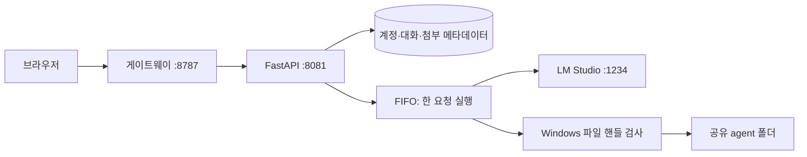

# 구성과 데이터 흐름

이 프로젝트는 Windows에서 LM Studio의 로컬 API를 사용하는 웹 채팅 서버다. UI, 계정, 파일 도구, 대기열과 원격 접속용 게이트웨이를 제공한다. 모델 가중치와 LM Studio 자체는 저장소에 포함하지 않는다.

로컬 실행의 세 포트는 loopback에 바인딩된다. WireGuard를 설정한 경우 게이트웨이만 지정한 사설 주소에 추가로 바인딩한다. 고정 HTTPS 주소의 전체 경로는 [원격 접속](REMOTE_ACCESS.md)을 참고한다.

| 파일 | 책임 |
| --- | --- |
| `sandbox-agent.html` | 로그인, 채팅·에이전트 전환, 파일 첨부, Markdown, 복사, 대기열 UI |
| `sandbox_agent.py` | 계정 인증, 대화·첨부 소유권, 모델 요청, 파일 도구 선택 |
| `sandbox_fs.py` | Windows 네이티브 핸들로 파일 작업 범위 검증 |
| `inference_queue.py` | 요청 순서, 제한, 시간 초과, 취소와 정리 |
| `gateway.py` | 단일 웹 원점, 내부 프록시, 선택적 VPN 리스너 |
| `vpn_access.py` | VPN·릴레이 설정과 전달된 클라이언트 정보 검증 |
| `local_urls.py` | 현재 설정에 맞는 접속 주소 결정 |
| `start.ps1` | LM Studio 준비 및 모델 로드, 백엔드·게이트웨이 시작 |
| `deploy/aws-relay/` | Linux `wg-easy` 네트워크 네임스페이스와 Nginx 사이의 선택적 릴레이 |

## 계정과 파일

SQLite DB와 첨부 원본은 `.runtime/sandbox-agent/`에 있다. 계정 비밀번호는 bcrypt 해시로 저장하고 세션 토큰은 해시를 저장한다. 대화와 첨부를 조회할 때 로그인 계정의 소유권을 확인한다. 공개 회원가입은 제공하지 않는다.

`agent/`의 파일은 모든 계정이 공유한다. 모델이 사용할 수 있는 도구는 목록, 읽기, 쓰기, 부분 수정, 폴더 생성과 검색이다. 파일 접근은 Windows 핸들의 최종 경로와 파일 속성을 검사하며 링크·정션·하드링크·ADS 등 우회 경로를 거부한다. 이 경계는 앱의 도구에 적용되며 서버 프로세스 자체를 OS 샌드박스에 넣는 것은 아니다.

## 요청 수명

새 대화의 기본 모드는 채팅이다. 에이전트 모드에서는 동일한 모델 호출에 여섯 파일 도구를 제공한다. 채팅 모드에서는 모델 도구 사용을 허용하지 않는다.

두 모드와 모든 계정이 하나의 FIFO 대기열을 사용한다. 한 요청의 모델 응답 및 후속 도구 왕복이 끝나야 다음 요청이 시작된다. 대기 요청은 최대 8개, 계정별 미완료 요청은 실행·대기를 합해 최대 2개다. 실행 제한은 15분, 대기 제한은 30분이다. 이는 처리 시간 보장이 아니라 무한 대기와 과부하를 제한하는 상한이다.

UI는 대기 순서와 자동 시작 안내를 보여 준다. 과부하로 거절된 제출은 DB에 새 메시지를 추가하지 않으며 입력 초안은 남긴다. 취소된 실행의 스트림과 진행 중인 파일 작업이 정리되기 전에는 다음 요청을 시작하지 않는다. 서버가 재시작되면 미완료 요청은 중단으로 표시하며 자동 재시도하지 않는다.

대기열은 프로세스 메모리에 있으므로 백엔드를 여러 worker로 실행하면 전역 직렬화가 깨진다. 이 프로젝트는 단일 백엔드 프로세스를 전제로 한다.

## 첨부와 렌더링

이미지는 지원되는 비전 모델에 전달한다. PDF·DOCX·텍스트는 추출한 텍스트를 문맥에 넣는다. 추출과 업로드에는 크기·개수·텍스트 길이 제한이 있으며 스캔 PDF에 대한 별도 OCR 파이프라인은 없다. 업로드 제한은 파일당 10 MiB다.

Markdown은 저장소에 포함된 Marked 렉서의 토큰을 이용해 DOM으로 렌더링한다. 모델이 만든 HTML을 그대로 삽입하지 않는다. 일반 텍스트 복사는 화면의 읽을 수 있는 문장을 복사하며 코드 내용의 기호는 보존한다.
