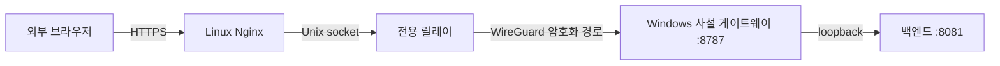

# 고정 HTTPS 주소로 원격 접속

로컬 설치는 loopback 전용으로 시작한다. 외부 PC·휴대폰에서 브라우저로 접속하려면 별도의 TLS 서버와 VPN 경로를 구성한다. 이 저장소는 클라우드 계정·도메인·인증서·WireGuard 키를 제공하거나 자동 생성하지 않는다. 외부 서버와 도메인의 비용은 사용하는 서비스에 따라 달라진다.

아래 구성은 Linux 서버의 Nginx와 Docker `wg-easy`, Windows의 WireGuard를 사용한다. 일반 WireGuard 호스트 네트워크나 다른 VPN 제품에 그대로 적용되는 자동 설치기는 아니다.



브라우저 접속 기기에 VPN 클라이언트를 설치하지 않아도 되는 구조다. TLS는 Nginx에서 종료하고, Nginx 이후 Windows까지는 WireGuard 경로를 사용한다. 앱 로그인은 계속 필요하다.

## 사전 준비

1. [로컬 설치와 로그인](../README.md)을 먼저 확인한다.
2. 운영할 Linux 서버에서 Nginx, Docker `wg-easy`, 도메인 DNS와 TLS 인증서를 준비한다. 기존 서버의 다른 사이트·VPN 피어를 보존한다.
3. Windows PC 전용 WireGuard 피어를 발급한다. Windows와 릴레이의 사설 주소를 고정하고 부팅 후 터널이 자동 시작되도록 운영자가 설정한다.
4. Windows 방화벽은 게이트웨이 TCP 8787에 대해 해당 WireGuard 인터페이스·주소·허용 피어만 받도록 제한한다. LM Studio 1234와 백엔드 8081을 인터넷에 직접 열지 않는다.

이 문서의 `ai.example.com`, `10.77.0.2`(Windows), `10.77.0.1`(릴레이)는 예시다. 실제 구성과 일치하도록 변경한다.

## Windows 게이트웨이 설정

[vpn-access.json.example](../config/vpn-access.json.example)과 [vpn-public.json.example](../config/vpn-public.json.example)의 필드를 읽고 자신의 주소를 적용한다. `shared_token`과 `relay_token`은 서로 다른 무작위 64자리 소문자 16진수 값이어야 한다. 예제에 들어 있는 문자열은 실제 토큰이 아니다.

새 설치에서만 다음처럼 토큰을 화면에 출력하지 않고 개인 설정 파일을 만들 수 있다. 이미 설정 파일이 있으면 이 명령은 덮어쓰지 않는다.

```powershell
@'
import json, pathlib, secrets
root = pathlib.Path.cwd()
for name, field in (("vpn-access.json", "shared_token"), ("vpn-public.json", "relay_token")):
    destination = root / ".runtime" / name
    if destination.exists():
        raise SystemExit("Existing private settings must be edited explicitly.")
    config = json.loads((root / "config" / (name + ".example")).read_text("utf-8"))
    config[field] = secrets.token_hex(32)
    destination.write_text(json.dumps(config, indent=2), encoding="utf-8")
'@ | .\.venv\Scripts\python.exe -
```

생성한 두 파일에서 Windows 사설 주소, 허용 피어 서브넷, HTTPS 호스트와 릴레이 주소를 확인한다. 설정 파일은 비공개로 유지한다. 새 WireGuard 구성을 활성화할 때 `.runtime/vpn-only` 파일을 만든다.

```powershell
New-Item -ItemType File -Path .runtime\vpn-only -ErrorAction Stop
```

`vpn-public.json`이 있으면 고정 HTTPS 원점을 사용하고, 해당 파일 없이 VPN 모드만 사용하면 VPN 내부 HTTP 접속이 된다. 잘못된 활성 설정은 다른 공개 주소로 조용히 전환하지 않고 실패해야 한다.

## Linux 릴레이와 Nginx

[relay.py](../deploy/aws-relay/relay.py)는 `wg-easy` 컨테이너의 네트워크 네임스페이스를 찾고 `/run/localai-relay/upstream.sock`을 제공한다. 감독 프로세스는 네임스페이스 관리에 필요한 권한을 사용하고 실제 연결 작업자는 `www-data`로 권한을 내린다. 이 구조와 [systemd 예제](../deploy/aws-relay/localai-relay.service)의 권한을 일반 웹 애플리케이션 서비스에 복사하지 않는다.

운영자가 검토하여 다음 항목을 자신의 서버에 배치한다.

- `relay.py`를 `/opt/localai-relay/`에 설치하고 서비스 파일의 컨테이너 이름·Windows upstream 주소·포트를 맞춘다.
- systemd 서비스 파일을 등록하고 Nginx가 접근할 Unix socket 그룹·권한을 확인한다.
- [Nginx location 예제](../deploy/aws-relay/nginx-location.conf.example)를 **자신의 HTTPS 가상 호스트** 안에 넣는다. 다른 사이트의 server 블록을 덮어쓰지 않는다.
- `Host`는 설정한 HTTPS 호스트로, `X-Real-IP`는 Nginx가 관측한 `$remote_addr`로 덮어쓴다. 클라이언트가 보낸 전달 헤더를 그대로 이어받지 않는다.
- 예제가 참조하는 루트 소유 비공개 토큰 include 파일에 `proxy_set_header X-LocalAI-Relay-Token "...";` 한 줄을 넣는다. 값은 Windows `vpn-public.json`의 `relay_token`과 같아야 한다. 토큰 파일은 저장소에 넣지 않는다.
- HTTP→HTTPS 전환, TLS 인증서 갱신, DNS A/AAAA 레코드는 별도로 구성한다. Nginx 설정을 검사한 뒤 필요한 서비스만 다시 읽게 한다.

릴레이 단위 검사는 운영 서버 없이 다음과 같이 실행할 수 있다.

```powershell
.\.venv\Scripts\python.exe -m unittest discover -s deploy/aws-relay -p test_relay.py -v
```

실제 Linux 네임스페이스·권한·서비스 시작 검사는 이 단위 검사와 별개다.

## 순서대로 확인

Windows 로컬 게이트웨이, Linux VPN 내부의 Windows 사설 주소, Nginx TLS, 마지막으로 외부 브라우저를 확인한다. 외부에서는 `/api/health`와 로그인 화면의 HTTPS 응답뿐 아니라 계정 로그인·기존 대화·첨부 접근도 검사한다. 다른 계정의 대화·첨부 URL이 거부되는지도 확인한다.

Windows가 재부팅되거나 모델을 준비하는 동안 upstream이 응답하지 않을 수 있다. Nginx 502만 보고 DNS나 인증서를 바꾸기 전에 로컬 앱·VPN·릴레이의 어느 구간이 끊겼는지 확인한다. 실제 자동 복구 여부는 [재부팅 검사](OPERATIONS.md#실제-재부팅-검사)로 기록한다.

Cloudflare 관련 설정 판독 코드는 호환 목적으로 남아 있을 수 있지만 시작 스크립트가 Cloudflare 터널을 자동 생성·실행하지는 않는다. 이 문서의 검증 대상 경로는 WireGuard와 HTTPS 릴레이다.
